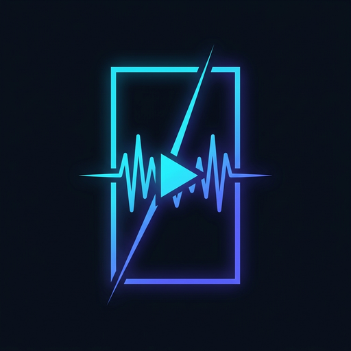
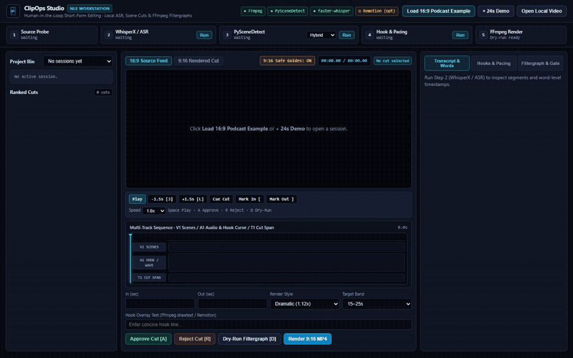
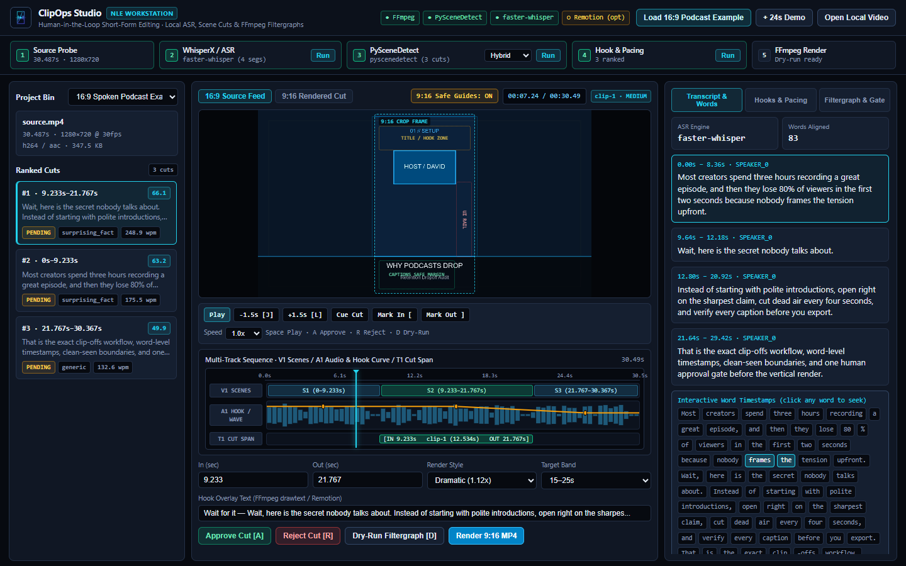
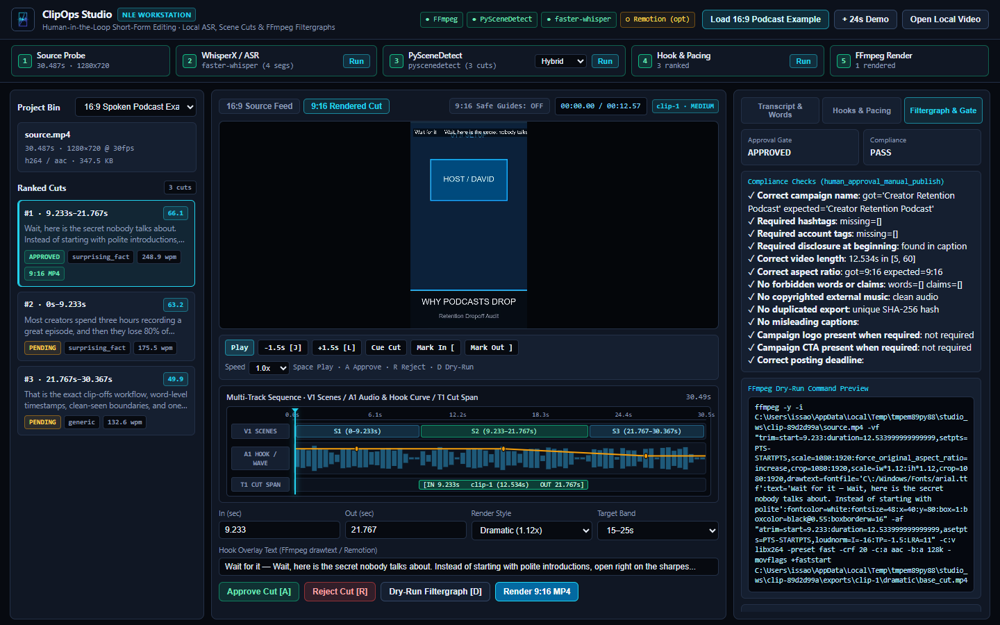
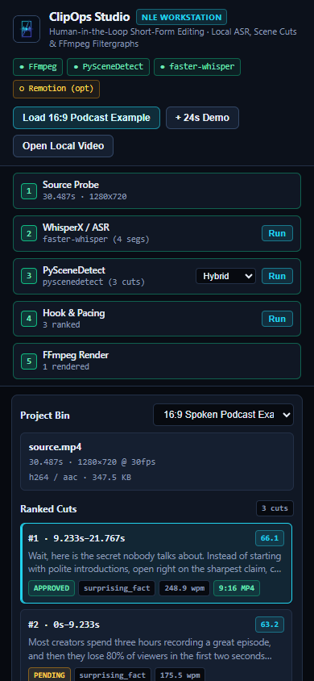
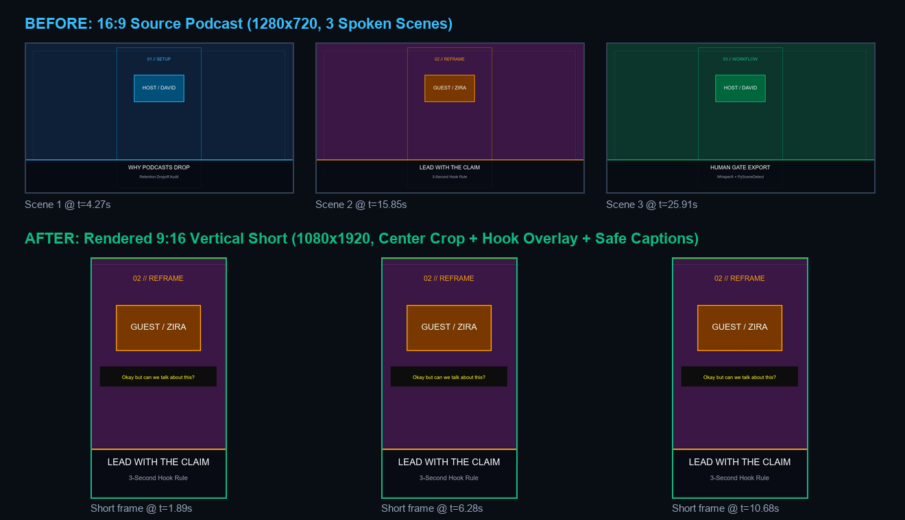
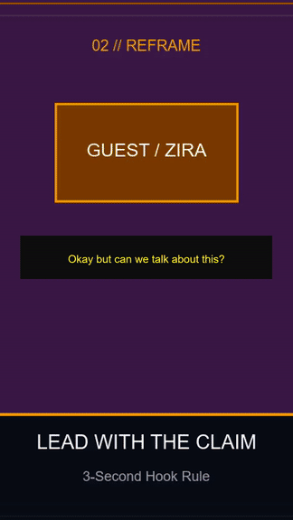
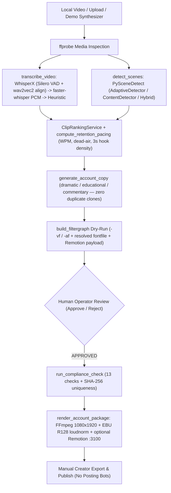
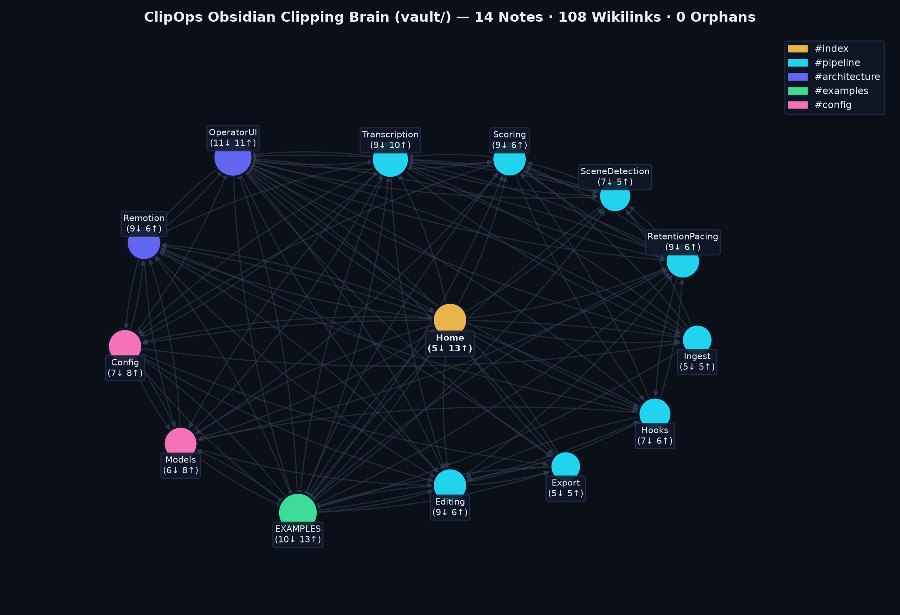
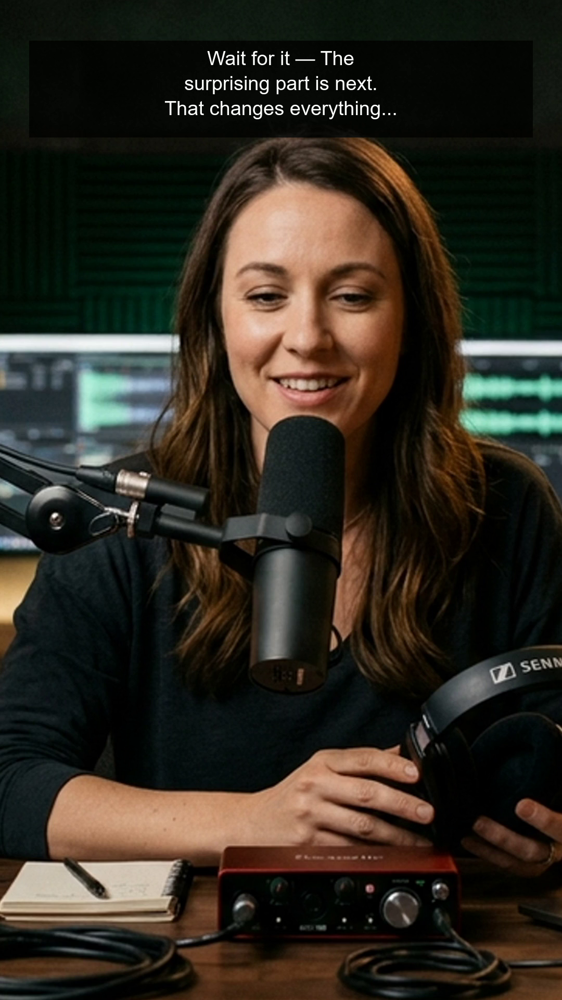

<p align="center">
  
</p>

<h1 align="center">ClipOps</h1>

<p align="center">
  <strong>Ethical Short-Form Video Clipping &amp; Editing Workstation</strong><br/>
  WhisperX / faster-whisper ASR · PySceneDetect Cut Analysis · Deterministic Hook &amp; Retention Scoring · FFmpeg &amp; Remotion 9:16 Rendering · Human Approval Gates
</p>

---

ClipOps turns long-form source video and a creative brief into curated, compliance-checked `1080×1920` (`9:16`) editorial cuts across three distinct creative styles (**Dramatic**, **Educational**, **Commentary**). It automates ingestion, forced-alignment transcription, scene cut detection, retention pacing math, and local FFmpeg/Remotion rendering — and **stops strictly before publishing**. Approval, posting, submission, and payout confirmation remain manual human clicks (`automation_boundary: human_approval_manual_posting` / `human_approval_manual_publish`).

---

## Live NLE Operator Studio Walkthrough



- Full MP4 screen recording (Playwright Chromium): [`docs/images/operator-ui-walkthrough.mp4`](docs/images/operator-ui-walkthrough.mp4)
- **Precision Dark-Mode NLE Features** (designed with `npx skills` → `find-skills` + `anthropics/skills@frontend-design`):
  - **Multi-Track Sequence Timeline**: `V1 SCENES` (PySceneDetect cut blocks), `A1 HOOK / WAVE` (FFmpeg 72-bin RMS PCM waveform + SVG hook-score curve), and `T1 CUT SPAN` (`[IN .. OUT]` range + interactive playhead scrub).
  - **9:16 Safe-Zone & Crop Guides**: Toggleable overlay over `16:9` source footage showing exact `9:16` center-crop bounds, top title zone, right platform UI rail, and bottom caption safe margin.
  - **Live Word-Level Transcript Sync**: Click any segment or aligned word chip (`83` words on the podcast example) to seek; active spoken words highlight live on `video.timeupdate`.
  - **NLE Transport & Hotkeys**: `Space` Play/Pause, `J` / `K` / `L` scrub, `Mark In [` / `Mark Out ]`, `A` Approve, `R` Reject, `D` Dry-Run Filtergraph.

| 16:9 Source + 9:16 Safe Guides (`1440×900`) | 9:16 Rendered Cut + Compliance Gate | Mobile (`390×844`) |
| :---: | :---: | :---: |
|  |  |  |

---

## Real End-to-End Example (`16:9` Spoken Podcast → `9:16` Vertical Short)

Reproduce from scratch with `.venv\Scripts\python.exe scripts/build_podcast_example.py` (or click **Load 16:9 Podcast Example** in the Studio UI):

1. **Source (`examples/sample_podcast_clip/source_podcast_16x9.mp4`)**: `1280×720` (`16:9`), `30.487s`, `355,881` bytes — 3 distinct spoken scenes generated with Windows `System.Speech` (`Microsoft David Desktop` & `Microsoft Zira Desktop`) + FFmpeg scene overlays.
2. **Real Offline ASR (`faster-whisper` `tiny`, CPU `int8`)**: Extracted `4` English transcript segments and `83` word-level timestamps directly from spoken audio (`engine: faster-whisper`).
3. **Shot-Boundary Detection (`PySceneDetect` `hybrid` → `adaptive`)**: Detected all `3` scene boundaries (`0.0–9.233s`, `9.233–21.767s`, `21.767–30.367s`).
4. **Deterministic Hook & Pacing Ranking**: Ranked Scene 2 (`9.233–21.767s`, `"Wait, here is the secret nobody talks about..."`) #1 (`total_score=66.1`, `hook_score=90.0`, `curiosity=85.0`, `conflict_surprise=80.0`, `hook_type=surprising_fact`, `248.9 WPM`, `8` words in the first `3s`).
5. **FFmpeg 16:9 → 9:16 Render (`docs/proof/example-rendered-clip.mp4`)**: Cropped to `1080×1920`, applied `commentary` zoom/overlay (`"Okay but can we talk about this?"`) and `loudnorm=I=-16:TP=-1.5:LRA=11` → `12.567s`, `316,968` bytes (`SHA-256: bc7dae99b0507280...`).

| Before (`16:9`) → After (`9:16`) Contact Sheet | Rendered `9:16` Short Preview |
| :---: | :---: |
|  |  |

---

## Architecture



---

## Repository Packages & Modules

| Module / Directory | Role |
| --- | --- |
| `apps/operator-ui/` | Lightweight local FastAPI Studio UI (`server.py`, `studio.py`, `static/`) + `cli.py` for step-by-step scene, transcript, hook, dry-run, and local render workflows without Postgres/Redis |
| `apps/api/` | Full FastAPI + SQLAlchemy + Celery backend (`/api/operator`, `/api/campaigns`, `/api/pipeline`, `/health` readiness & security audit) |
| `apps/dashboard/` | Next.js 15 + React 19 + Tailwind operator console |
| `workers/transcription/` | `transcribe_video`: WhisperX (`wav2vec2` forced alignment + Silero VAD), `faster-whisper` 16 kHz PCM float32 path (bypassing PyAV 19 `metadata_errors`), and deterministic heuristic fallback |
| `workers/scene_detection/` | `detect_scenes`: PySceneDetect `ContentDetector`, `AdaptiveDetector`, and `hybrid` cut detection with `8.0s` `ffprobe` fallback |
| `workers/clip_ranking/` | Regex hook classifier (`question`, `surprising_fact`, `controversy`, `drama`, `payoff`) and segment ranker |
| `workers/caption_generation/` | Style-specific hook & disclosure copy generator (`dramatic`, `educational`, `commentary`) |
| `workers/video_rendering/` | `build_filtergraph` (dry-run preview + cross-platform `fontfile` resolution) & `render_account_package` (`1080×1920`, `loudnorm=I=-16:TP=-1.5:LRA=11`) |
| `packages/services/` | `ClipRankingService` (with `compute_retention_pacing`), `CampaignScoringService`, `ForecastService`, `PerformanceLearningService` |
| `packages/compliance_checker/` | 13-point fail-closed compliance validator (hashtags, disclosures, duration bands, aspect ratio, forbidden phrases, SHA-256 uniqueness, logo/CTA gates) |
| `packages/campaign_parser/` | Deterministic brief parser (`CPM`, budget, geo, duration bounds, hashtags, disclosure) |
| `templates/` | Remotion 4.0 React caption compositing service (`server.js` on `:3100`, `Dramatic`/`Educational`/`Commentary` compositions) |
| `vault/` | 14-note interconnected Obsidian Clipping Brain (`Home.md`, `.obsidian/graph.json`, **0 orphan notes**) |
| `browser-extension/` | Manifest V3 read-only brief/asset helper on a logged-in tab (never auto-clicks Join/Submit/Withdraw) |

---

## Tools, Skills, AI Models & Pipelines Used

| Category | Component | Version / Details | Purpose in ClipOps |
| --- | --- | --- | --- |
| **Speech & Alignment** | WhisperX + Silero VAD (`wav2vec2`) | Optional CUDA (`scripts/install_whisperx_cuda.py`) | Word-level forced-alignment timestamps (`whisperx.align`) & optional pyannote diarization |
| **Speech Fallback** | `faster-whisper` (CTranslate2) | `1.2.1` (`tiny`/`base`/`small`/`medium`/`large-v3`, CPU `int8` / CUDA `float16`) | Local offline ASR fed via 16 kHz mono PCM NumPy buffer (avoids PyAV 19 `av.open` regression) |
| **Scene Cut Detection** | PySceneDetect + OpenCV | `scenedetect==0.7.3`, `opencv-python-headless==5.0.0.93` | `ContentDetector(threshold=27.0)` & `AdaptiveDetector(adaptive_threshold=3.0)` cut segmentation |
| **Video & Audio DSP** | FFmpeg / FFprobe | `8.1.2` (tested on Windows & Linux) | `9:16` crop/zoom filtergraphs, cross-platform `drawtext` burn-in, EBU R128 `loudnorm` (`-16 LUFS`) |
| **Caption Compositing** | Remotion | `4.0.499` + React `18.3.1` + Express `4.22.2` | Optional animated React overlays (`Dramatic`, `Educational`, `Commentary`) via `/local-file` proxy |
| **Backend & Queue** | FastAPI, SQLAlchemy, Pydantic, Celery, Redis | `fastapi==0.115.6`, `sqlalchemy==2.0.36`, `celery==5.4.0` | Operator Studio API, full production API, eager inline or Redis async task pipeline |
| **Frontend** | Vanilla HTML/CSS/JS Studio & Next.js Dashboard | `next==15.5.22`, `react==19.2.8` | Zero-build local Operator Studio UI + full multi-page Next.js console |
| **Verification & Visuals** | Pytest, Playwright, Matplotlib, NetworkX | `pytest==8.3.4`, `playwright==1.65.1` | Automated tests, headless Chrome screenshots/video, Obsidian vault graph verification |
| **Engineering Skills** | `find-skills`, `frontend-design`, `image-generator`, `verification-before-completion` | Vercel Skills CLI + custom studio logo + strict post-edit proof | Applied precision NLE design principles to `apps/operator-ui/`, generated `clipops-logo.png`, verified all checks against live tool runs |

---

## Quick Start (Step-by-Step)

### 1. Create Environment & Install Dependencies

```powershell
# From repo root
uv venv .venv --python 3.12
uv pip install --python .venv\Scripts\python.exe -r apps/api/requirements.txt
```

*(Ensure `ffmpeg` and `ffprobe` are on your `PATH`. Optional GPU WhisperX: see `scripts/install_whisperx_cuda.py`.)*

### 2. Launch the Lightweight Local Operator Studio UI (Recommended)

No Postgres, Redis, or Node build required:

```powershell
.venv\Scripts\python.exe apps/operator-ui/cli.py serve --host 127.0.0.1 --port 8010
```

Open `http://127.0.0.1:8010`:
1. Click **Load 16:9 Podcast Example** (or **+ 24s Demo**, or **Open Local Video** to load your own `.mp4`/`.mov`/`.webm`).
2. Step through **Source Probe → WhisperX / ASR → PySceneDetect (Hybrid / Content / Adaptive) → Hook & Pacing**, or scrub directly on the `V1 / A1 / T1` multi-track timeline.
3. Click any segment or aligned word chip in **Transcript & Words** to seek, toggle **9:16 Safe Guides**, and audit retention pacing (WPM, dead-air ratio, 3s hook density).
4. Click **Dry-Run Filtergraph [D]** to preview the exact `-vf`/`-af` FFmpeg command and 13-point compliance gate.
5. Click **Approve Cut [A]** (or **Reject Cut [R]**), then **Render 9:16 MP4** to export and preview the `1080×1920` output locally.

### 3. CLI Workstation Commands

```powershell
# Inspect local media stack readiness
.venv\Scripts\python.exe apps/operator-ui/cli.py health

# Run full synthetic 24s demo (probe -> scenes -> score -> approve -> dry-run -> render)
.venv\Scripts\python.exe apps/operator-ui/cli.py demo --out-json docs/proof/cli-demo-summary.json

# Step-by-step on any local video
.venv\Scripts\python.exe apps/operator-ui/cli.py scenes my_video.mp4 --detector hybrid
.venv\Scripts\python.exe apps/operator-ui/cli.py dry-run my_video.mp4 --start 0 --end 15 --style dramatic --hook "Wait until you see this"
.venv\Scripts\python.exe apps/operator-ui/cli.py render my_video.mp4 --start 0 --end 15 --style dramatic --out-dir storage/my_cut
```

### 4. Full Stack (API + Next.js Dashboard + Optional Remotion)

- **API**: `export PYTHONPATH="$PWD:$PWD/apps/api" && CELERY_EAGER=true uvicorn app.main:app --app-dir apps/api --port 8000`
- **Dashboard**: `cd apps/dashboard && npm install && npm run dev` (`http://localhost:3000`)
- **Remotion (optional)**: `cd templates && npm install && npm start` (`http://127.0.0.1:3100`)

---

## Obsidian Clipping Brain (`vault/`)

Open `vault/` as an Obsidian vault starting at [`vault/Home.md`](vault/Home.md). It maps every algorithm, math formula, and sharp edge directly to repository files with **14 notes, 108 wikilinks, and 0 orphan notes** (enforced by automated pytest verification):



---

## Verified Test & Demo Proof

- **Test Suite (`pytest tests -v`)**: **`26 passed, 4 warnings`** (`docs/proof/pytest.txt`), covering core parsers/scoring/compliance, Windows cross-platform `drawtext` font resolution, PyAV 19 PCM workaround, full SQLite API smoke pipeline, Operator Studio FastAPI + CLI workflow, 16:9→9:16 Podcast Example + 72-bin RMS waveform extraction, adaptive/content/hybrid PySceneDetect, retention pacing math, and Obsidian vault zero-orphan integrity.
- **16:9 Spoken Podcast Example (`scripts/build_podcast_example.py`)**: Synthesized `30.487s` `1280×720` 3-scene podcast (`355,881` bytes), transcribed real English speech via `faster-whisper` (`4` segments, `83` word timestamps), detected `3` PySceneDetect cuts, scored Scene 2 (`9.233–21.767s`) #1 (`66.1`, `hook_score=90.0`), and rendered `1080×1920` `docs/proof/example-rendered-clip.mp4` (`316,968` bytes, `SHA-256: bc7dae99b0507280...`).
- **Offline Worker Demo (`scripts/demo_offline.py docs/proof`)**: Generated `12.0s` `1080×1920` source (`138,180` bytes), detected `3` PySceneDetect scenes (`0–4s`, `4–8s`, `8–12s`), rendered `4.0s` dramatic package (`88,394` bytes, `render_error: null`), and demonstrated fail-closed compliance holding `4.0s not in [20, 45]`.
- **Operator Studio NLE UI Capture (`docs/proof/studio-demo-summary.json`)**: Executed the full browser workflow on `16:9 Spoken Podcast Example (David + Zira)`, verified all `13/13` compliance checks, and rendered local `1080×1920` MP4 alongside desktop/mobile PNGs + MP4 (`588,212` B) & GIF (`9,948,891` B) walkthroughs.

| Offline Dramatic Frame (`docs/proof/sample-frame.png`) |
| :---: |
|  |

Deep-dive documentation: [`docs/CASE_STUDY.md`](docs/CASE_STUDY.md) · [`docs/PROOF_OF_WORK.md`](docs/PROOF_OF_WORK.md) · [`docs/USER_WORKFLOW.md`](docs/USER_WORKFLOW.md) · [`docs/EXAMPLES.md`](docs/EXAMPLES.md).
