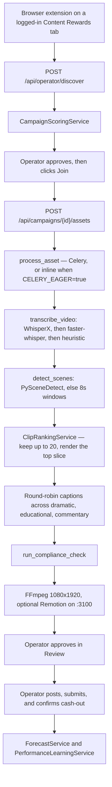

# ClipOps

ClipOps is an operator console for Content Rewards clipping. It scores a brief, cuts a source video into a few different 9:16 packages, and stops before the actions that spend the account. Join, TikTok post, Content Rewards submit, and cash-out stay manual. `GET /health` reports that as `automation_boundary: human_approval_manual_posting`.

The sidebar text “~85–90% automated” is UI copy. It is not a measurement from the runs below.

## Architecture



| Piece | Role |
| --- | --- |
| `apps/api` | FastAPI, SQLAlchemy, Celery tasks |
| `apps/dashboard` | Next.js operator UI |
| `browser-extension` | Manifest V3 assist on an existing session. No auto-click |
| `workers/` | Transcription, scenes, rank, captions, FFmpeg render |
| `packages/` | Scoring, compliance, forecast, campaign parse |
| `templates/` | Remotion overlay service on port 3100 |
| `vault/` | Obsidian map of the same pipeline. Open that folder as a vault and start at `Home` |
| `workflows/n8n` | Optional notification webhooks |

State moves only through `ALLOWED_TRANSITIONS` in `packages/shared_types/constants.py`. There is no edge that posts.

## Demo

Both runs were on this tree with no private API keys and no GPU. WhisperX was not installed. Remotion was not started. The source is a generated 12 second 1080×1920 color sequence plus a 440 Hz tone, so faster-whisper correctly returned no speech.

Offline, from the repo root:

```bash
export PYTHONPATH="$PWD:$PWD/apps/api"
python3 scripts/demo_offline.py docs/proof
```

Recorded in `docs/proof/demo-summary.json`:

- Source ffprobe: `12.000000` s, `138181` bytes, H.264 1080×1920, AAC
- Transcript: `heuristic`, because `whisperx: No module named 'whisperx' | faster-whisper: empty segments`
- Scenes: `pyscenedetect`, three windows (0–4, 4–8, 8–12)
- Campaign score for the VoltPop brief: `65.0`, recommendation `AVOID`, no reject reasons (the score is under the 70 `CONSIDER` band)
- Top window 8–12s scored `67.3`, hook `surprising_fact`, prediction `MEDIUM`
- Dramatic render: `4.000000` s, `86902` bytes, 1080×1920, `render_error` null
- Compliance: failed, `4.0s not in [20, 45]`


The same file uploaded through the API (`CELERY_EAGER=true`, model `tiny`, CPU int8) reached asset status `GENERATED` and three `REVIEW_REQUIRED` versions. Approval-card scores were 67.9, 62.14, and 62.14, all `MEDIUM`, all compliance-failed. Card `expected_earnings` was `25.362`, which is `campaign.expected_profit` from the formula, not money received. Home showed current earnings `0`. The 8210 views and £2 CPM on that screen are the defaults in `ForecastService.forecast` when no performance rows exist.

`GET /health` on that process: `readiness_pct` 67 (`eager_inline`). Present: ffmpeg, faster-whisper, PySceneDetect. Absent: torch (`No module named 'torch'`), WhisperX, Remotion, Redis.

`GET /api/operator/readiness`: score `40`, target `99`. Done items were the three seeded accounts, a discovered campaign, processed footage, and a draft render. Posting was not done.


`python3 -m pytest tests` → `17 passed, 4 warnings in 12.25s` (`docs/proof/pytest.txt`).

Full tables: [docs/EXAMPLES.md](docs/EXAMPLES.md). The same numbers are linked inside the vault at [vault/EXAMPLES.md](vault/EXAMPLES.md). Design notes: [docs/CASE_STUDY.md](docs/CASE_STUDY.md).

## Stack

Versions below are copied from the repo manifests. Where a manifest uses a range, the “resolved” column is the version `npm` or `pip` selected in this audit on 2026-11-13. Those are not lockfile pins unless the lockfile column says so.

### Python — `apps/api/requirements.txt`

| Package | Manifest |
| --- | --- |
| fastapi | `==0.115.6` |
| uvicorn[standard] | `==0.34.0` |
| sqlalchemy | `==2.0.36` |
| psycopg[binary] | `>=3.2.0` (audit install `3.3.9`) |
| pydantic | `==2.10.4` |
| pydantic-settings | `==2.7.0` |
| python-jose[cryptography] | `==3.3.0` |
| passlib[bcrypt] | `==1.7.4` |
| bcrypt | `==4.0.1` |
| python-multipart | `==0.0.20` |
| celery | `==5.4.0` |
| redis | `==5.2.1` |
| httpx | `==0.28.1` |
| pytest | `==8.3.4` |
| scenedetect | `>=0.6.4` (audit install `0.7.3`) |
| opencv-python-headless | `>=4.8.0` (audit install `5.0.0.93`) |
| faster-whisper | `>=1.0.0` (audit install `1.2.1`) |

WhisperX, torch, torchvision, and torchaudio are not in that list. `scripts/install_whisperx_cuda.py` is the optional CUDA path. PyAV is not a direct requirement. The audit install resolved `av==19.0.2`, which removed `metadata_errors` from `av.open`. Transcription passes ffmpeg PCM into faster-whisper so that call is not required.

There is no Python lockfile.

### Dashboard — `apps/dashboard/package.json`

Lockfile `apps/dashboard/package-lock.json` (140 packages). Direct dependencies:

| Package | Range | Locked |
| --- | --- | --- |
| next | `^15.1.3` | 15.5.22 |
| react | `^19.0.0` | 19.2.8 |
| react-dom | `^19.0.0` | 19.2.8 |
| lucide-react | `^0.469.0` | 0.469.0 |
| class-variance-authority | `^0.7.1` | 0.7.1 |
| clsx | `^2.1.1` | 2.1.1 |
| tailwind-merge | `^2.6.0` | 2.6.1 |
| tailwindcss | `^3.4.17` | 3.4.19 |
| typescript | `^5.7.2` | 5.9.3 |
| postcss | `^8.4.49` | 8.5.23 |
| autoprefixer | `^10.4.20` | 10.5.4 |
| @types/node | `^22.10.5` | 22.20.1 |
| @types/react | `^19.0.2` | 19.2.17 |
| @types/react-dom | `^19.0.2` | 19.2.3 |

### Remotion service — `templates/package.json`

Lockfile `templates/package-lock.json` (370 packages). Direct dependencies:

| Package | Range | Locked |
| --- | --- | --- |
| remotion | `^4.0.240` | 4.0.499 |
| @remotion/bundler | `^4.0.240` | 4.0.499 |
| @remotion/cli | `^4.0.240` | 4.0.499 |
| @remotion/media-utils | `^4.0.240` | 4.0.499 |
| @remotion/renderer | `^4.0.240` | 4.0.499 |
| express | `^4.21.2` | 4.22.2 |
| react | `^18.3.1` | 18.3.1 |
| react-dom | `^18.3.1` | 18.3.1 |
| typescript | `^5.7.2` | 5.9.3 |
| @types/react | `^18.3.12` | 18.3.31 |

### Other manifests

| Tool | Where |
| --- | --- |
| Python 3.11 | `apps/api/Dockerfile` (`python:3.11-slim`) plus ffmpeg |
| Node 20 | `templates/Dockerfile` (`node:20-bookworm-slim`) plus Chromium |
| Postgres 15 | `docker-compose.yml` (`postgres:15-alpine`) |
| Redis 7 | `docker-compose.yml` (`redis:7-alpine`) |
| n8n | `docker-compose.yml` (`n8nio/n8n:latest`) |
| Chrome extension | `browser-extension/manifest.json` v3, version `0.2.0`, no npm manifest |
| SQL | `supabase/migrations/20260727100000_init.sql`, `20260727120000_operator_mode.sql` |

System tools the workers shell out to, not declared as packages: `ffmpeg` and `ffprobe`. This audit used ffmpeg 6.1.1.

## Setup

Copy `.env.example` to `.env` when you want overrides. Development boots with the demo password and warns about it. `CLIPOPS_ENV=production` refuses a weak JWT or a missing bcrypt hash. Rotate with:

```bash
python3 scripts/rotate_secrets.py --print-password
```

### API

From the repo root. `PYTHONPATH` must include the repo root and `apps/api` (workers live at the root; the app package lives under `apps/api`).

```bash
python3 -m venv .venv
source .venv/bin/activate
pip install -r apps/api/requirements.txt
export PYTHONPATH="$PWD:$PWD/apps/api"
export CELERY_EAGER=true
export DATABASE_URL=sqlite:///./clipops.db
cd apps/api
uvicorn app.main:app --reload --port 8000
```

Windows PowerShell, from `apps/api`:

```powershell
$env:PYTHONPATH = "..\..;$PWD"
$env:CELERY_EAGER = "true"
uvicorn app.main:app --reload --port 8000
```

Sign in as `operator@clipops.local`. Password is `changeme` until you rotate. Seed sample campaigns from Home (“Seed demo top 3”) or `POST /api/operator/demo/seed-top3`.

### Dashboard

```bash
cd apps/dashboard
npm install
npm run dev
```

`NEXT_PUBLIC_API_URL` defaults to `http://127.0.0.1:8000`.

### Optional

- Remotion overlays: `cd templates && npm install && npm start` (port 3100). Without it, FFmpeg still cuts and burns the hook.
- Redis and a worker: set `CELERY_EAGER=false` and run `celery -A app.celery_app.celery worker --loglevel=info`. `scripts/start_stack.ps1` is the Windows helper.
- CUDA WhisperX: `scripts/install_whisperx_cuda.py`.
- Extension: [browser-extension/README.md](browser-extension/README.md).
- Compose: `docker compose up` uses `.env` and applies both SQL migrations on a fresh Postgres volume.
- Tests: `PYTHONPATH="$PWD:$PWD/apps/api" python3 -m pytest tests`
- Vault: open `vault/` in Obsidian. `Home.md` links every note. `.obsidian/graph.json` colors index, pipeline, examples, and config.

Daily loop and the manual gates: [docs/USER_WORKFLOW.md](docs/USER_WORKFLOW.md). Secrets: [docs/SECRETS.md](docs/SECRETS.md).
