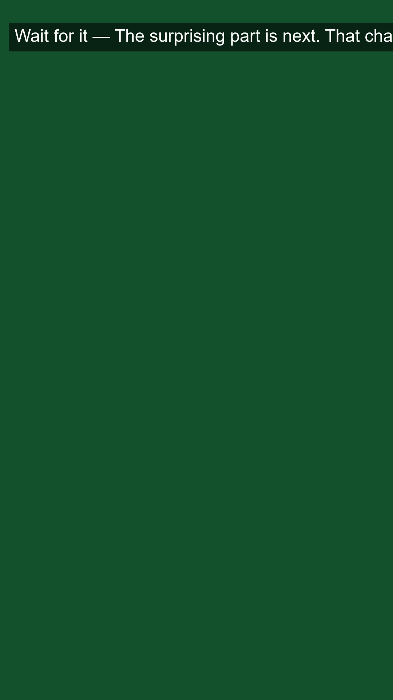
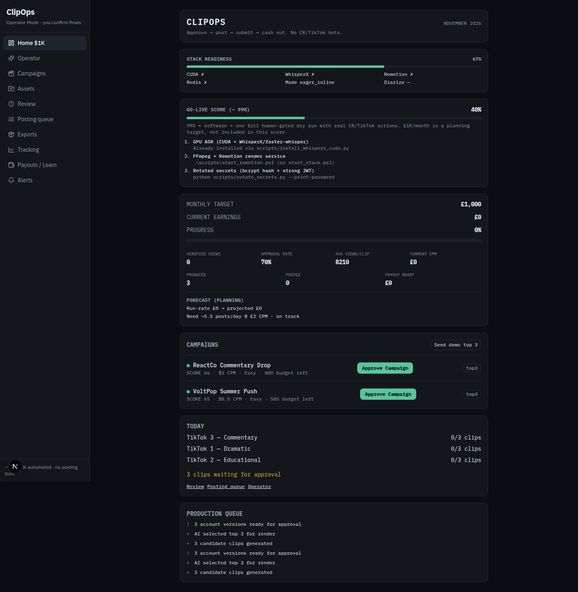
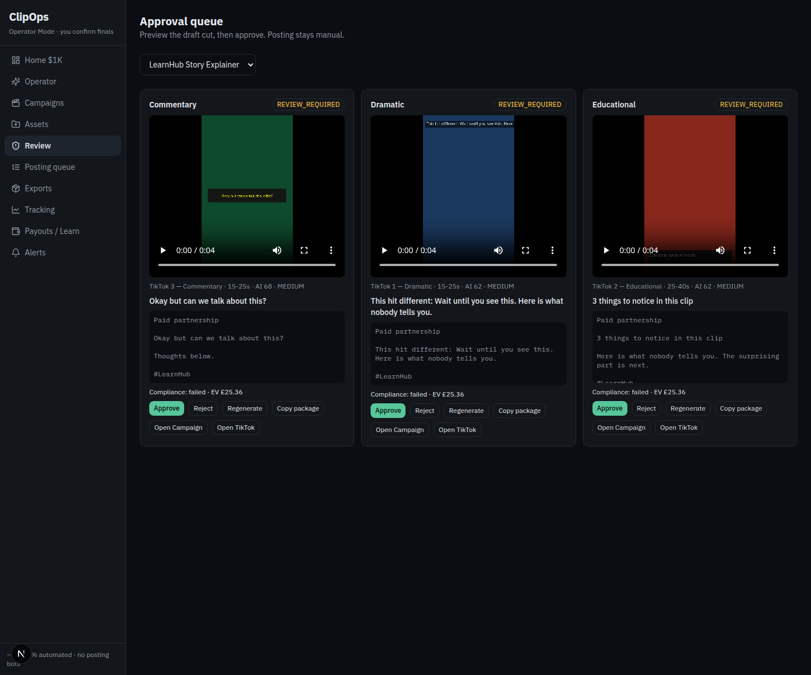

# Examples

Concrete inputs and outputs from this repository. Nothing here is a target or a guessed metric. Planning constants that the code uses when it has no history are labeled as constants.

Two runs:

1. `python3 scripts/demo_offline.py docs/proof` — no API, no keys, no GPU, no Remotion.
2. A local API on `127.0.0.1:8000` with `CELERY_EAGER=true`, SQLite, `WHISPERX_MODEL=tiny`, `WHISPERX_DEVICE=cpu`, `ENABLE_DIARIZATION=false`, and `REMOTION_URL` empty. Dashboard screenshots are from `127.0.0.1:3000` after signing in as `operator@clipops.local`.

Raw files: `docs/proof/demo-summary.json`, `docs/proof/api-session.json`, `docs/proof/review-cards.json`, `docs/proof/pytest.txt`.

## Offline sample

The script builds a 12 second 1080×1920 H.264 file: three 4 second color fields concatenated, plus a 440 Hz tone. ffprobe on that file reported duration `12.000000`, size `138181`, video `h264` 1080×1920, audio `aac`.

Transcription requested faster-whisper `tiny` on CPU int8. WhisperX is not installed. faster-whisper returned no segments on the tone, so the worker used the heuristic transcript. Recorded fallback:

`whisperx: No module named 'whisperx' | faster-whisper: empty segments`

PySceneDetect returned three windows: 0–4s, 4–8s, 8–12s (`engine: pyscenedetect`).

The brief parser read CPM `8.5`, hashtags `#VoltPop` and `#ContentRewards`, tag `@voltpop`, duration 20–45. `CampaignScoringService` returned score `65.0`, recommendation `AVOID`, `reject_reasons: []`. That is the under-70 band, not a hard reject.

Clip scores for those three windows:

| Window | Total | Hook type | Prediction | Text used |
| --- | --- | --- | --- | --- |
| 8–12s | 67.3 | surprising_fact | MEDIUM | The surprising part is next. That changes everything. Here is the payoff. |
| 0–4s | 60.1 | question | MEDIUM | Wait until you see this. Here is what nobody tells you. |
| 4–8s | 60.1 | question | MEDIUM | Here is what nobody tells you. The surprising part is next. |

The dramatic package for the 8–12s window rendered. ffprobe: duration `4.000000`, size `86902`, 1080×1920 H.264 plus AAC. `render_error` was null. Compliance passed every check except duration: `4.0s not in [20, 45]`. The brief asked for 20–45 seconds and the scene was 4 seconds, so `passed` is false.

`pytest tests` on this machine: `17 passed, 4 warnings in 12.25s` (`docs/proof/pytest.txt`).

## API session

`GET /health` returned `status: ok`, `readiness_pct: 67`, `mode: eager_inline`. True: ffmpeg, faster-whisper, PySceneDetect, eager Celery. False: torch/CUDA (`No module named 'torch'`), WhisperX, Remotion, Redis, diarization. Security message: `demo password in use — rotate before any shared deploy`.

`POST /api/operator/demo/seed-top3` ingested 4 campaigns. Top three by the API:

| Name | Score | Eligible |
| --- | --- | --- |
| LearnHub Story Explainer | 66.7 | yes |
| ReactCo Commentary Drop | 65.5 | yes |
| VoltPop Summer Push | 64.6 | yes |

`Exhausted Fake Engage` was ineligible and `operator_status: rejected`. Reject reasons included budget utilisation at 95% (the 90% threshold), a geography mismatch, and fake engagement.

Approving LearnHub returned `campaign_id` `63123ad5-4935-4abb-9b50-3e52c144d237` and next steps that tell the operator to click Join. Uploading the same 12 second file finished inline with asset status `GENERATED` and:

`transcript_engine=heuristic; whisperx: No module named 'whisperx' | faster-whisper: empty segments`

Approval cards after the commentary filter fix (`docs/proof/review-cards.json` was captured before that reprocess; scores did not depend on the filter):

| Style | Account | Band | AI score | Prediction | Compliance | Hook |
| --- | --- | --- | --- | --- | --- | --- |
| commentary | TikTok 3 — Commentary | 15-25 | 67.9 | MEDIUM | false | Okay but can we talk about this? |
| dramatic | TikTok 1 — Dramatic | 15-25 | 62.14 | MEDIUM | false | This hit different: Wait until you see this. Here is what nobody tells you. |
| educational | TikTok 2 — Educational | 25-40 | 62.14 | MEDIUM | false | 3 things to notice in this clip |

`expected_earnings` on each card was `25.362`. That field is `campaign.expected_profit` from the scoring formula. Home at the same time reported current earnings `0`, progress `0`, produced `3`, posted `0`, and `3` clips waiting. The 8210 average views and £2 CPM on Home are the defaults in `ForecastService.forecast` (`avg_views_per_clip=8210.0`, `planning_cpm=2.0`) because no performance rows existed.

`GET /api/operator/readiness` returned score `40`, target `99`. Done: 3 TikTok accounts, a discovered campaign, footage processed, a draft render. Not done: CUDA ASR, FFmpeg+Remotion as a pair, rotated secrets, an approved export, a posted URL, a submission, logged views.

Export sizes under the temp storage root after the commentary `drawbox` fix and a reprocess:

| File | Bytes |
| --- | --- |
| account-1/video.mp4 (commentary) | 86633 |
| account-2/video.mp4 (dramatic) | 87386 |
| account-3/video.mp4 (educational) | 82060 |

Before that fix, commentary `video.mp4` was 0 bytes. `RENDER_ERROR.txt` quoted ffmpeg exit 234. The filter used `drawbox=w=w*0.86`, and `w` is the box width. The code now uses `iw` and `ih`.

Posting was not clicked. Earnings stayed 0.
