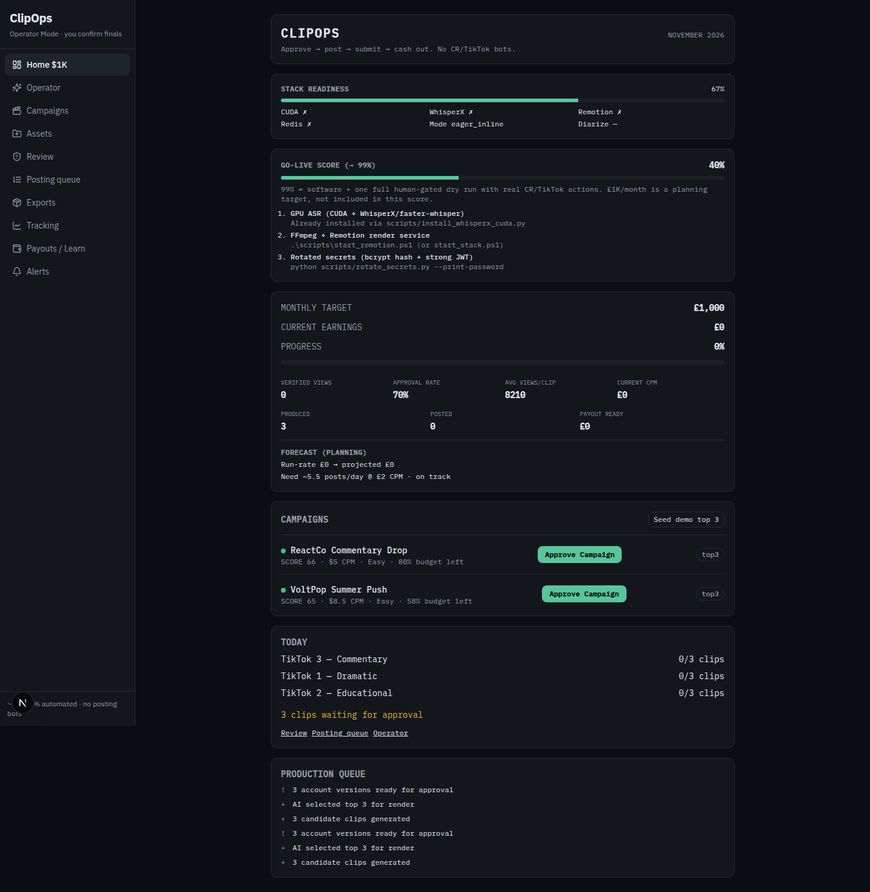
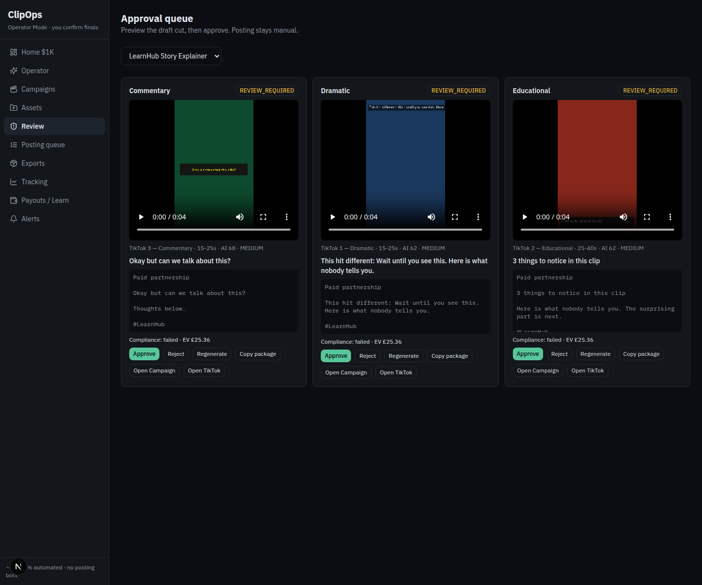

---
tags:
  - examples
---

# Examples

Same runs as `docs/EXAMPLES.md`, linked into the vault. [[Ingest]] [[Transcription]] [[Scoring]] [[Hooks]] [[Editing]] [[Export]]

## Offline command

```bash
python3 scripts/demo_offline.py docs/proof
```

No API key, GPU, Redis, or Remotion. The script writes `docs/proof/demo-summary.json`.

Source ffprobe: 12.000000 seconds, 138181 bytes, H.264 1080×1920, AAC.

| Stage | Recorded result |
| --- | --- |
| Transcript engine | `heuristic` |
| Fallback | `whisperx: No module named 'whisperx' \| faster-whisper: empty segments` |
| Scenes | `pyscenedetect`, windows 0–4, 4–8, 8–12 |
| Campaign | VoltPop Summer Push, CPM 8.5, score 65.0, recommendation `AVOID`, no reject reasons |
| Top clip | 8–12s, total 67.3, hook `surprising_fact`, prediction `MEDIUM` |
| Render | dramatic, 4.000000s, 86902 bytes, 1080×1920, `render_error` null |
| Compliance | `passed: false`, duration detail `4.0s not in [20, 45]` |


Tests: `17 passed, 4 warnings in 12.25s` in `docs/proof/pytest.txt`.

## Local API

Health: `readiness_pct` 67, `eager_inline`. Present: ffmpeg, faster-whisper, PySceneDetect. Absent: torch, WhisperX, Remotion, Redis.

Seed scores from `POST /api/operator/demo/seed-top3`: LearnHub 66.7, ReactCo 65.5, VoltPop 64.6, all eligible. `Exhausted Fake Engage` rejected for 95% budget use, geography, and fake engagement.

Upload of the same file: asset status `GENERATED`, same heuristic fallback string. Three `REVIEW_REQUIRED` versions:

- commentary, score 67.9, “Okay but can we talk about this?”
- dramatic, score 62.14, “This hit different: …”
- educational, score 62.14, “3 things to notice in this clip”

Card `expected_earnings` was 25.362 (`campaign.expected_profit`). Home current earnings were 0. The 8210 views and £2 CPM on Home are `ForecastService` defaults, not measured views.

Go-live score from `GET /api/operator/readiness`: 40, target 99. Four checklist items were done (accounts, discovery, processed footage, draft render). Posting was not.

After the commentary `drawbox` fix, reprocess wrote:

- commentary `video.mp4` 86633 bytes (it had been 0 bytes, ffmpeg exit 234)
- dramatic `video.mp4` 87386 bytes
- educational `video.mp4` 82060 bytes





[[Home]] [[Config]] [[Models]]
