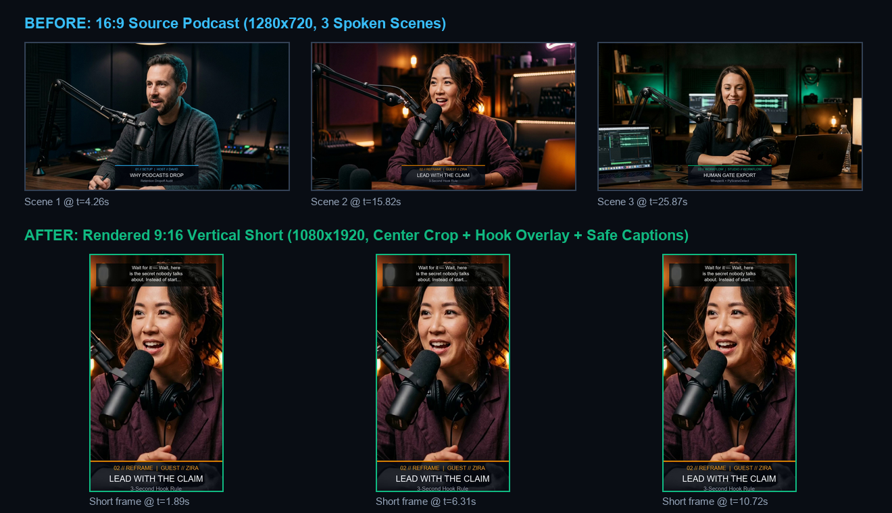
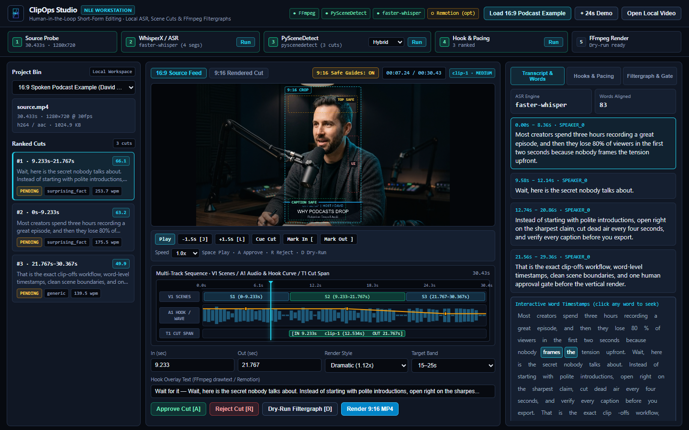
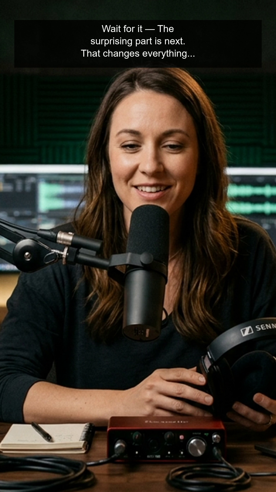

---
tags:
  - examples
---

# Verified Pipeline Examples

Linked from [[Home]], [[Ingest]], [[Transcription]], [[SceneDetection]], [[Scoring]], [[RetentionPacing]], [[Hooks]], [[Editing]], [[Remotion]], [[Export]], [[OperatorUI]], [[Config]], [[Models]].

All values below were captured from actual runs on this repository (local Windows 11, CPU `faster-whisper` + `PySceneDetect` + `FFmpeg 8.1.2`, no external WhisperX GPU or Remotion server required).

## 1. End-to-End 16:9 Spoken Podcast Example (`source_podcast_16x9.mp4` → 9:16 Short)

Generated by `scripts/build_podcast_example.py` (`docs/proof/example-podcast-summary.json`, `examples/sample_podcast_clip/source_podcast_16x9.mp4`):

- **Source Video**: `1280×720` (`16:9`), `30.433s`, `1,049,461` bytes (`SHA-256: a77d73267cc73f38...`), 3 spoken scenes built from synthetic AI studio keyframes (`scene1_host.png`, `scene2_guest.png`, `scene3_studio.png`, demo media) + Windows `System.Speech` (`Microsoft David Desktop` + `Microsoft Zira Desktop`) + FFmpeg lower-thirds.
- **Transcription (`faster-whisper`, CPU `int8`)**: `4` real ASR segments and `83` word-level timestamps across all 30s (`"Most creators spend three hours..."`, `"Wait, here is the secret nobody talks about..."`, etc.).
- **Scene Detection (`PySceneDetect`, `adaptive` via `hybrid`)**: detected all `3` scenes cleanly: `0.0–9.233s` (`9.233s`), `9.233–21.767s` (`12.534s`), `21.767–30.367s` (`8.6s`).
- **Top Candidate (`cand-1`, Scene 2 `9.233–21.767s`)**:
  - `total_score`: `66.1` (`hook_score=90.0`, `curiosity=85.0`, `conflict_surprise=80.0`, `hook_type=surprising_fact`)
  - `retention_pacing`: `53` words, `wpm: 253.7` (`FAST_ENERGETIC`), `spoken_sec: 9.17s`, `dead_air_ratio: 0.269`, `hook_window_words_3s: 8`
- **Rendered 9:16 Output (`docs/proof/example-rendered-clip.mp4`)**: `1080×1920`, `12.617s`, `795,315` bytes (`SHA-256: 5a68c2b29619787c...`), wrapped 3-line `dramatic` top hook (`<=26` chars/line) + `loudnorm=I=-16:TP=-1.5:LRA=11`, previewed in `docs/proof/example-frame-strip.png` and `docs/proof/example-rendered-preview.gif` (`2,071,642` bytes).

## 2. Operator Studio NLE UI Walkthrough

Captured via `scripts/capture_operator_ui.py` (`docs/proof/studio-demo-summary.json`), running the NLE Workstation UI on `16:9 Spoken Podcast Example (David + Zira)` with multi-track timeline (`V1 Scenes`, `A1 Audio + Hook Curve`, `T1 Cut Span`), toggleable `9:16` safe-zone guides, interactive word-level seeking, dry-run filtergraph preview, human `APPROVED` compliance gate, and local `9:16` MP4 export:

## 3. Offline Worker Script (`scripts/demo_offline.py docs/proof`)

Recorded in `docs/proof/demo-summary.json`:

- **Source**: `12.000000s`, `138,180` bytes, `1080×1920` H.264/AAC
- **PySceneDetect**: 3 cuts (`0–4s`, `4–8s`, `8–12s`)
- **Brief Score (VoltPop Summer Push)**: `65.0`, recommendation `AVOID`, `reject_reasons: []` (below `70` threshold)
- **Top Clip (`8–12s`)**: `67.3` (`surprising_fact`, `MEDIUM`)
- **Dramatic Render**: `4.0s`, `88,394` bytes (`render_error: null`), compliance held on `4.0s not in [20, 45]`

## 3. Test Suite (`docs/proof/pytest.txt`)

- `.venv/Scripts/python.exe -m pytest tests -v` → **`25 passed, 4 warnings in 29.52s`** (includes `tests/test_core.py`, `tests/test_smoke_pipeline.py`, and `tests/test_studio_and_vault.py`).
